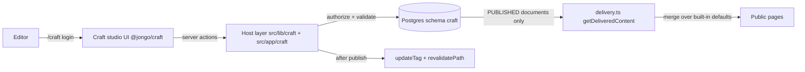

# How to set up Jongo Craft on a Next.js site, define schemas and migrate existing content

Audience: developers adding a Craft content studio to an existing Next.js / React website, for example `manifestfts/mfts-2026`.
Reference implementation: `dd-thegolflab` (The Golf Lab), branch `platform-preview`. Package: `@jongo/craft` (preview, currently `0.1.0-preview.25`). Everything below that is not marked "verify" was read in that code.

Craft is a self-hosted content studio that lives inside the customer's own site at `/craft`, stores content in the site's own PostgreSQL database, and lets the public pages read PUBLISHED content with a safe fallback to the copy shipped in code. It is not the hosted Jongo CMS: there is no Jongo API call at page time.

## 1. Decide if Craft is the right path

| Question | Craft (this guide) | Hosted Jongo CMS delivery (what `mfts-2026` has today) |
| --- | --- | --- |
| Where does content live? | The site's own Postgres database, schema `craft` | Jongo OS, read over HTTPS with a bearer token |
| Editing UI | `/craft` inside the site | Jongo OS |
| Page-time dependency | Site database (fail-soft to built-in copy) | Jongo origin (a failure is `503`, no fallback) |
| Fits | One site that owns its copy, fast to adopt | Multi-site marketing content with release snapshots |

`mfts-2026` reads fixtures through `src/lib/content.ts` and a Jongo marketing adapter (`src/lib/marketing-content.ts`, `docs/marketing-content-adapter.md`). Adopting Craft there means adding the Craft host layer next to it and swapping the data source, not removing the adapter first (see section 9).

## 2. What you are adding



Pieces:

1. **`@jongo/craft` package**: studio UI, schema DSL, validation, Postgres store (`/server`), Sign in with Jongo helpers (`/auth`).
2. **Schemas** (`defineType`): your content model, plain TypeScript in the website.
3. **Host layer**: the site's own server code that owns the database pool, sessions, authorization, rate limits and the `/craft` route. Craft itself reads no environment and has no users.
4. **Seed and delivery**: seed documents come from your built-in defaults; delivery reads the published variants and merges them over those defaults field by field.

## 3. Prerequisites

- Next.js App Router (the Golf Lab runs 16.3; verify older versions before use), React 19, TypeScript. Node >= 22.12 (the `groq-js` dependency needs it). Read the site's `AGENTS.md` and `node_modules/next/dist/docs/` first: these Next versions have breaking changes.
- A PostgreSQL 16 or 17 database **dedicated to Craft** (never the site's other data).
- On Coolify: the app container has `NODE_ENV=production`, which the migrate and seed scripts use to allow the internal database host.
- For editors: either the shared emergency password or Sign in with Jongo (section 8).

## 4. Step 1: install the package

The package is distributed as a tarball vendored in the website repo, so deployment needs nothing but the site checkout.

```bash
# from the website repo
mkdir -p vendor
cp ../dd-thegolflab/vendor/jongo-craft-0.1.0-preview.25.tgz vendor/      # or pack it yourself:
#   cd <jongo>/craft && npm ci --ignore-scripts && npm test && npm pack --pack-destination <website>/vendor
npm install --save-exact ./vendor/jongo-craft-0.1.0-preview.25.tgz
npm install pg groq-js            # runtime dependencies for the server store
npm install -D typescript         # the seed script transpiles your TypeScript content module
npm install jose                  # only if you will use Sign in with Jongo
npm install -D @types/pg
```

- Add `"engines": { "node": ">=22.12" }` to `package.json`.
- Commit `vendor/*.tgz`, `package.json` and the lockfile. Do not gitignore `vendor/`. Deployment runs `npm ci && npm run build`.
- The Golf Lab keeps a `craft:repack` script (`scripts/repack-craft.mjs`) that rebuilds the tarball from the sibling `jongo/craft` checkout and reinstalls it. Copy it only if the site will track Craft source changes.
- In server code import `@jongo/craft/server`; never from client components. If your bundler inlines packages, mark `@jongo/craft` external for server code so the migrations directory resolves.

Import map:

| Import | Use |
| --- | --- |
| `@jongo/craft` | `ContentStudio`, `defineType`, `defineField`, `defineArrayMember`, `craftStructure`, `StudioIdentity`, `CraftLoginCard` |
| `@jongo/craft/content` | Pure schema and validation helpers, `createContentRegistry`, no React |
| `@jongo/craft/server` | `runMigrations`, `createPgExecutor`, `saveDraft`, `publishDocument`, `getDocument`, `queryDataset`, import/export |
| `@jongo/craft/auth` | Sign in with Jongo relying-party helpers, `mapRoleToActions` |
| `@jongo/craft/studio.css` | Studio styles, imported in the `/craft` page |

## 5. Step 2: create the database and run migrations

1. Create a separate database and an owner role used only for migrations. Create a least-privilege role for the running app:

   ```sql
   CREATE ROLE craft_app LOGIN PASSWORD '<store in the host secret store>' NOSUPERUSER NOCREATEDB NOCREATEROLE;
   GRANT CONNECT ON DATABASE <database> TO craft_app;
   -- run after the first migration, and again after any migration that adds tables:
   GRANT USAGE ON SCHEMA craft TO craft_app;
   GRANT SELECT, INSERT ON craft.datasets, craft.revisions, craft.mutations, craft.audit_log, craft."references" TO craft_app;
   GRANT SELECT, INSERT, UPDATE ON craft.documents TO craft_app;   -- no DELETE, no TRUNCATE, no DDL
   ```

   Verify the current grant list against `jongo/docs/craft-preview.md` ("Server persistence") because new migrations can add tables.
2. Set the environment (names only here, values in the host's secret store, never in git):

   | Variable | Meaning |
   | --- | --- |
   | `CRAFT_PREVIEW_ENABLED` | Exactly `true` turns `/craft` on, anything else is a 404. Server-only |
   | `JONGO_CRAFT_DATABASE_URL` | Connection string of the Craft database |
   | `JONGO_CRAFT_DATASET` | Dataset name, default `production`. Pattern `[a-z0-9][a-z0-9_-]{0,63}` |
   | `JONGO_CRAFT_SESSION_SECRET` | At least 32 characters. `node -e "console.log(require('crypto').randomBytes(32).toString('hex'))"` |
   | `JONGO_CRAFT_STUDIO_PASSWORD` | Emergency shared password, at least 12 characters |
   | `JONGO_CRAFT_BREAKGLASS_ENABLED` | See section 8 |
   | `JONGO_CRAFT_DELIVERY_ENABLED` | Exactly `true` makes the public pages read published content. Also set it at build time |
   | `JONGO_CRAFT_DELIVERY_REVALIDATE_SECONDS` | Optional, 5 to 3600, default 60 |
   | `JONGO_CRAFT_DEBUG` | Exactly `true` shows developer text in the studio |
   | `JONGO_CRAFT_ALLOW_REMOTE_DB` | Only for a developer machine that deliberately targets a remote database. Never set it in the app |

3. Run the migration (the app never migrates on boot):

   ```bash
   npm run craft:migrate
   ```

   It creates the `craft` schema, applies the SQL in the package's `migrations/` under an advisory lock, stores checksums, and is idempotent. It refuses non-loopback database hosts unless `NODE_ENV=production` or `JONGO_CRAFT_ALLOW_REMOTE_DB=true`. On Coolify run it as a post-deployment command or in the app terminal.

Backups are plain PostgreSQL backups (for example Coolify scheduled database backups). Craft has no backup feature.

## 6. Step 3: define the schemas

Create `src/lib/craft-content.ts`. Schemas are code owned by the website, so they are reviewed and deployed like any other code. The studio and the server validate documents with the same descriptors.

```ts
import { craftStructure, defineArrayMember, defineField, defineType, type StudioConfig } from '@jongo/craft';

const hero = defineType({
  name: 'hero', title: 'Hero', type: 'document', schemaVersion: 1, singleton: true, preview: { title: 'headline' },
  fields: [
    defineField({ name: 'headline', title: 'Headline', type: 'string', required: true, maxLength: 120 }),
    defineField({ name: 'body', title: 'Body', type: 'portableText', required: true }),
    defineField({ name: 'ctaUrl', title: 'Button link', type: 'url', required: true }),
    defineField({ name: 'image', title: 'Image', type: 'image', altRequired: true })
  ]
});
```

Field types and options (from `craft/src/schema.ts`):

| `type` | Options |
| --- | --- |
| `string`, `text`, `url`, `date`, `datetime` | `minLength`, `maxLength` |
| `number` | `min`, `max`, `integer` |
| `boolean`, `portableText` | none |
| `slug` | `maxLength`, `source` (field name) |
| `enum` | `options: string[]` (unique) |
| `reference` | `to: string[]` (type names), `weak` |
| `image` | `altRequired` (asset picker, uploads need media storage) |
| `object` | `fields` |
| `array` | `of: Descriptor[]`, `minItems`, `maxItems` |

Common to every field: `title`, `description`, `required`, `publishRequired` (may be empty in a draft, must be filled to publish), `private` (removed from public reads and exports).

Rules of thumb:

- **Singleton vs collection.** A singleton is a fixed document your code reads by id (`hero`, `siteSettings`, a page's copy). Set `singleton: true`: the studio hides Duplicate and Delete, and the host layer must refuse both server-side. A collection type (work projects, articles) omits `singleton`.
- **Document ids.** Singletons get stable ids you export in one place (the Golf Lab uses `DELIVERY_DOC_IDS`, for example `main-hero`, `membership`). Never generate them. Collection documents need ids that are valid per `isValidDocumentId` in the host layer (use the slug, for example `work-ncwf`).
- **Schema versions.** Start at `schemaVersion: 1`. When a field changes meaning, bump it and handle old documents in the delivery narrowing step.
- **Keep operations out.** Bookings, payments, members and similar transactional data must never be Craft documents. Craft is for copy, images and settings.
- **Names.** A type name matches `^[a-zA-Z][\w.-]*$` and must be unique.

Navigation, in the same file:

```ts
const open = craftStructure.document;
export const structure = craftStructure.define([
  craftStructure.group('Homepage', [open('hero', 'main-hero', 'Hero')]),
  craftStructure.group('Work', [craftStructure.documents('workProject', 'Projects')]),   // a list of every document of the type
], [hero, /* every schema */]);

export const siteContent: StudioConfig = { schemas: [hero /* ... */], documents: [/* seed documents */], assets: [/* known images */], structure };
```

`craftStructure.define` throws at startup when an entry points at a type missing from `schemas`, or when a document entry is repeated. Without `structure`, every type gets a list.

## 7. Step 4: add the host layer and the `/craft` route

Copy these from `dd-thegolflab` and adapt names. The files are plain website code (a shared extraction into the package is not done yet), so keep them in step with the Golf Lab when it changes.

| Path in the website | Purpose |
| --- | --- |
| `src/lib/craft/config.ts` | Reads the environment and reports only NAMES of what is missing. Persistence is on only when database URL, session secret and one usable sign-in method are valid; otherwise `/craft` opens in a labelled LOCAL DRAFT mode that writes nothing |
| `src/lib/craft/db.ts` | Lazy `pg.Pool` singleton on `globalThis` (max 5), never logs the URL |
| `src/lib/craft/session.ts`, `cookies.ts`, `origin.ts`, `rate-limit.ts` | HMAC session token (`v1` password, `v2` Jongo), `HttpOnly` cookie scoped to `/craft`, same-origin check for every action, login throttling |
| `src/lib/craft/service.ts`, `actors.ts` | Builds the registry from your schemas, the `authorize` callback (fail-closed), list/load/save/publish/unpublish/discard/duplicate/delete |
| `src/lib/craft/input.ts`, `results.ts`, `errors.ts` | Validates action input shape and size, maps every error to a fixed message (no SQL or document text) |
| `src/lib/craft/delivery.ts` | Reads PUBLISHED documents for the public pages (section 10) |
| `src/lib/craft/media.ts` | Optional B2 media storage (section 11) |
| `src/lib/craft/sso.ts` | Sign in with Jongo settings (section 8) |
| `src/app/craft/actions.ts`, `session-actions.ts` | `'use server'` actions the studio calls, each re-checking flag, persistence, same-origin and session |
| `src/app/craft/login/page.tsx`, `src/app/craft/auth/{start,callback}/route.ts` | Login page and the SSO routes |
| `src/app/craft/[[...segments]]/page.tsx` | Renders `ContentStudio`; gate `CRAFT_PREVIEW_ENABLED === 'true'` else `notFound()`; `noindex` |
| `scripts/craft-migrate.mjs`, `craft-seed.mjs`, `craft-revoke.mjs`, `scripts/lib/db-guard.mjs`, `scripts/lib/load-ts.mjs` | Operator scripts (section 5 and 9) |

Then:

1. Add `package.json` scripts: `craft:migrate`, `craft:seed`, `craft:revoke` (copy from the Golf Lab).
2. Point `service.ts` and the page at your `craft-content.ts` export instead of `golfContent`.
3. In the page import `@jongo/craft/studio.css` and keep `export const dynamic = 'force-dynamic'`.
4. Keep `/craft` out of search (`robots: { index: false, follow: false }`) and out of any public sitemap.
5. After a successful publish or unpublish the actions call `revalidateDelivery()`. Keep that or public pages update only after the revalidate window.
6. Do not set `NEXT_PUBLIC_` on any Craft variable.

The authorize callback in `service.ts` allows `read`, `read-drafts`, `write` and `publish` on the configured dataset for a valid session and denies `admin`, `import`, `export*` and every other dataset. Roles from Jongo SSO narrow this further through `mapRoleToActions`.

## 8. Sign-in and access

Two methods exist; the Golf Lab uses both.

**Emergency shared password.** `JONGO_CRAFT_STUDIO_PASSWORD` plus `JONGO_CRAFT_SESSION_SECRET`. Rate limited (5 failures per address, 30 global per 15 minutes). Rotating the session secret signs everyone out; rotating the password does not end existing sessions. With SSO off, this login stays on unless `JONGO_CRAFT_BREAKGLASS_ENABLED=false`. With SSO on, it is off unless that variable is exactly `true`.

**Sign in with Jongo** (OIDC authorization code with PKCE, EdDSA ID tokens). Per site:

1. In Jongo, register one client for the app (Site): `node scripts/oidc-register-client.mjs register --site-id <uuid> --name "<Site> Craft" --redirect-uri https://<site>/craft/auth/callback [--dataset production]`. The secret prints once.
2. Set on the website: `JONGO_CRAFT_SSO_ENABLED=true`, `JONGO_CRAFT_SSO_ISSUER`, `JONGO_CRAFT_SSO_CLIENT_ID`, `JONGO_CRAFT_SSO_CLIENT_SECRET`, `JONGO_CRAFT_SSO_REDIRECT_URI` (exactly the registered URI), optional `JONGO_CRAFT_SSO_SESSION_MINUTES`.
3. Jongo must have `JONGO_OIDC_ENABLED=true` and `JONGO_CMS_ENABLED=true`, a signing key, and migration `20261106120000` applied.
4. Who can sign in: Jongo platform admins (implicit admin on every site), the client owner and client admins (admin), and anyone with an explicit per-app grant (reader, editor, publisher or admin) from the app's **Jongo Craft** panel in Jongo. The Jongo account's email must be verified; the site rejects unverified emails.
5. If someone cannot sign in, run `node scripts/oidc-diagnose.mjs --email <them> --client-id <jc_...> --redirect-uri <uri> --dataset <name>` inside the Jongo container, and read the `[craft-access] denied: <reason>` line in the Jongo log.

Design and threat model: `docs/craft-sso-design.md`.

## 9. Step 5: seed the content

Seeding turns your built-in defaults into the first draft documents, so editors start from what the site shows today.

1. Put the defaults in `src/lib/craft-defaults.ts` as plain `ContentDocument` objects (`_id`, `_type`, fields). The same defaults feed the public pages when Craft is off or unreachable, which keeps the site working without a database.
2. List them in `documents` in `craft-content.ts`.
3. Run:

   ```bash
   npm run craft:seed -- --fill --publish
   ```

   - No flags: creates a DRAFT for each document that does not exist yet; never changes an existing one.
   - `--fill`: adds fields a stored document does not have yet (use after the model grows). Existing values are never touched.
   - `--publish`: publishes what this run created or filled.
   - Idempotent. Resolves references in passes. Prints counts only.
4. Open `/craft`: every document appears with its seed content, ready to edit.

Collections: a studio in this preview has no blank "New document" button (verify in your build). Create collection entries in the seed or by Duplicating an existing one in the studio.

## 10. Step 6: read published content on the public pages

Pattern (see `src/lib/craft/delivery.ts` and `src/lib/craft-delivery-content.ts` in the Golf Lab):

1. `readPublishedContent` reads the `published` perspective with consumer `public` (private fields stripped) using an authorize callback that allows only `read` on the dataset. It never reads drafts.
2. `resolveContent` merges each document over the built-in default **field by field**. Every field is checked: type, length, control characters, safe URLs (`https`, `mailto`, `tel`, same-site paths), image addresses limited to files shipped with the site or the media store. Anything missing or invalid falls back to the default for that field. Unknown keys are ignored.
3. `getDeliveredContent()` returns the default content when `JONGO_CRAFT_DELIVERY_ENABLED` is not `true`, otherwise a cached result (`unstable_cache`, tag `craft-delivery`, revalidate 60 s). A database error becomes one short warning plus the built-in copy.
4. Pages and layout call `getDeliveredContent()` instead of importing copy constants.
5. Publish/unpublish call `revalidateDelivery()` (`updateTag` + `revalidatePath('/')`). With several instances the others converge within the revalidate window.

Rich text is Portable Text. Render it yourself from `block` nodes: styles `normal`, `h2`, `h3`, `h4`, `blockquote`; decorators `strong`, `em`, `code`; link marks; lists `bullet` and `number`. Do not render unknown node types.

## 11. Media

Existing images stay as files in the site (`/assets/...`) and are registered as known assets so image fields validate:

```ts
const asset = (a: { id: string; url: string; filename: string }) => ({ _id: a.id, _type: 'sanity.imageAsset', url: a.url, originalFilename: a.filename });
// StudioConfig.assets = knownImages.map(asset)
```

An image field value is `{ _type: 'image', asset: { _ref: '<asset id>' }, alt: '...' }`. Uploads need object storage (Backblaze B2, S3 compatible): set `JONGO_CRAFT_B2_ENDPOINT`, `_REGION`, `_BUCKET`, `_KEY_ID`, `_APP_KEY`, `JONGO_CRAFT_MEDIA_PUBLIC_BASE_URL` and `JONGO_CRAFT_MEDIA_PREFIX` (one folder per client in the shared bucket). All server-only. Without them the picker lists existing images and upload is hidden. `npm run craft:media-check` verifies the bucket and browser-upload CORS. Uploaded images are served only when their address is inside the media base URL.

## 12. Migrating content from an existing site

Do this in order. Each step is independently reversible, and the site keeps its built-in copy as the fallback throughout.

1. **Inventory.** List every user-visible string, image and link that an editor should be able to change, per page. Leave out layout, navigation structure that never changes, legal text you do not want edited, and anything transactional.
2. **Classify.** One-off page copy becomes a singleton per page or section. Repeating things (projects, articles, team members, FAQs) become a collection type, or an `array` of objects inside a singleton when the list is short and ordered by hand (FAQ, steps, benefits).
3. **Model.** Write the schemas (section 6). Match limits to real content (`maxLength` slightly above the longest existing string). Mark fields `required` only if the page breaks without them; use `publishRequired` for things that may be blank in a draft.
4. **Extract defaults.** Move the strings and images out of components into `craft-defaults.ts` objects shaped like the documents. Components keep receiving the same props. Run the site: it must look identical.
5. **Convert rich text.** Wrap each paragraph in a `block` node (`{ _type: 'block', _key, style: 'normal', children: [{ _type: 'span', _key, text, marks: [] }] }`). Bold and italic become `strong` and `em` marks; links become `markDefs` of `_type: 'link'` with `href`. Use `ensurePortableTextKeys` from `@jongo/craft/content` to fill missing `_key`s. Keep Markdown or MDX bodies that are code-heavy in the repo.
6. **Register images.** List each existing image as a known asset, then reference it in documents (section 11).
7. **Seed.** `npm run craft:seed -- --fill --publish` against the target database. Open `/craft` and confirm every document shows and validates (the header chip lists issues).
8. **Switch delivery on.** Set `JONGO_CRAFT_DELIVERY_ENABLED=true` (also at build time) and redeploy. Because the seed equals the defaults, nothing visibly changes. Edit and publish a document, reload the page within the revalidate window, and confirm the change.
9. **Cut over component by component.** Replace imports of copy constants with `getDeliveredContent()` fields. Delete a default only after the page is covered by a test (section 14).
10. **Rollback.** Unset `JONGO_CRAFT_DELIVERY_ENABLED` (or `CRAFT_PREVIEW_ENABLED`): the site serves the built-in copy and `/craft` returns 404. No data is lost.

Bulk import from another Sanity-style system is possible with `importNdjson` (all or nothing, nothing overwritten; `drafts.` ids become drafts; assets are skipped) but needs a host action with the `import` right, which the Golf Lab denies. Use it from a one-off script with its own authorize callback, run only locally against a copy, and publish after review.

## 13. Worked example: `mfts-2026`

Today `src/lib/content.ts` exports `workProjects`, testimonials and fixtures, and `src/lib/marketing-content.ts` can read the hosted Jongo CMS. A Craft migration would look like this.

Inventory and mapping:

| Existing | Craft model |
| --- | --- |
| `WorkProject` (slug, name, category, headline, summary, services, tone, gallery, attribution) | collection type `workProject` |
| Testimonials | collection type `testimonial` |
| Articles (`src/app/articles/[slug]`) | collection type `article` with a `portableText` body |
| Service pages (`src/app/services/*`) | one singleton per page, or one `servicePage` collection if the layout is identical |
| Homepage hero, pricing, FAQ | singletons |
| `sourceUrl`, `sourcePath`, provenance and permission notes | stay in code or `private: true`; never public fields |

Example schema for the work collection:

```ts
export const workProject = defineType({
  name: 'workProject', title: 'Work project', type: 'document', schemaVersion: 1, preview: { title: 'name' },
  fields: [
    defineField({ name: 'slug', title: 'URL slug', type: 'slug', required: true, source: 'name', maxLength: 80 }),
    defineField({ name: 'name', title: 'Name', type: 'string', required: true, maxLength: 80 }),
    defineField({ name: 'category', title: 'Category line', type: 'string', maxLength: 80 }),
    defineField({ name: 'headline', title: 'Headline', type: 'string', required: true, maxLength: 140 }),
    defineField({ name: 'summary', title: 'Summary', type: 'text', required: true, maxLength: 600 }),
    defineField({ name: 'services', title: 'Services', type: 'array', maxItems: 8, of: [defineArrayMember({ type: 'string', maxLength: 60 })] }),
    defineField({ name: 'tone', title: 'Card tone', type: 'enum', options: ['sage', 'blush', 'sand'] }),
    defineField({ name: 'gallery', title: 'Gallery', type: 'array', maxItems: 12, of: [defineArrayMember({ type: 'object', title: 'Image', fields: [
      defineField({ name: 'image', title: 'Image', type: 'image', required: true, altRequired: true }),
      defineField({ name: 'caption', title: 'Caption', type: 'string', maxLength: 140 })
    ] })] }),
    defineField({ name: 'attribution', title: 'Attribution', type: 'text', maxLength: 300 })
  ]
});
```

Steps specific to this site:

1. Keep the existing `WorkProject` TypeScript type as the contract of the pages. Add `src/lib/craft/delivery.ts` and a `resolveWork(documents)` function that narrows Craft documents into that shape, falling back to the fixture entry with the same slug.
2. Seed one document per fixture project with id `work-<slug>`, copying `gallery` images as known assets (`/approved-assets/...`).
3. Because the site has an approval and provenance process for published excerpts and images, keep `contentMode`/`publicationNotice` and the approval rules in code. Craft must not publish anything the approval process has not cleared, so keep the studio behind the preview flag and restrict editors until that process is mapped to roles.
4. The hosted adapter and Craft are alternative sources for the same shape. Add a `CONTENT_SOURCE`-style switch if both must coexist; do not read both on the same page.
5. Plan the host layer files for the site's conventions (`src/lib`, `src/app`, TypeScript path aliases, the `.next` output override `MFTS_BUILD_OUTPUT` for isolated builds) and read the site's `AGENTS.md` before touching Next APIs.

## 14. Tests and verification

Minimum for a new site (patterns exist in the Golf Lab `tests/*.test.mjs` and `scripts/test-craft-*.mjs`):

- Config: every environment combination reports only names, never values; flag off is a 404.
- Schemas: each seed document validates against its schema; ids are unique; the structure only points at existing types.
- Delivery narrowing: invalid, oversized, missing and unsafe fields fall back to the default; unknown keys are dropped.
- Authorization: no session denies everything; import, export and admin are denied; reader sessions cannot write.
- Database: a throwaway PostgreSQL runs `craft:migrate`, `craft:seed` (twice, to prove idempotence), then save, publish, delivery read and unpublish.
- Browser: login, edit, save draft, publish, public page shows the change after revalidation; widths 360, 390, 768, 1440; `/craft` is `noindex`.
- Build: clean `npm ci && npm run build` in a directory that contains only the site (no sibling `jongo` checkout).

## 15. Troubleshooting

| Symptom | Check |
| --- | --- |
| `/craft` is a 404 | `CRAFT_PREVIEW_ENABLED` is exactly `true` on the server, and you redeployed |
| Studio says "Changes are not saved in this session" or shows LOCAL DRAFT MODE | A required name is missing or too short: database URL, session secret (32+), a sign-in method. Set `JONGO_CRAFT_DEBUG=true` to see the names |
| `migration_checksum_mismatch` or `migration_missing` | A migration file changed, or the package is older than the database: install the matching package version |
| `craft:seed refused` | Non-loopback database outside `NODE_ENV=production`; run it in the app container, not on a laptop |
| Public page ignores edits | Delivery not enabled at build and run time, document not published, or the revalidate window has not passed |
| Editor cannot sign in with Jongo | Section 8 step 5: `oidc-diagnose.mjs` and the `[craft-access] denied:` log line |
| Images do not show | The asset id is not registered, or an uploaded address is outside `JONGO_CRAFT_MEDIA_PUBLIC_BASE_URL` |

## 16. Known limits of the preview

- Not production-hardened: read `docs/craft-preview.md` (security decisions and limits) before exposing it to a client.
- Sessions: `npm run craft:revoke -- <jongo-user-id>` signs one Jongo person out of the site right away (they can sign in again if Jongo still grants access). The in-memory password-session revocation list and the login rate limits are per server instance.
- Each GROQ query or export loads the whole dataset (guarded at 10,000 documents and 64 MiB). Do not expose `queryDataset` to anonymous traffic.
- The host layer is copied per site, not shared from the package.
- Public delivery is a read of a small fixed set of documents; it is not a general content API. A site with large collections should add its own narrowing and pagination.
- The package version is a preview, so pin it exactly and test an upgrade before deploying.
