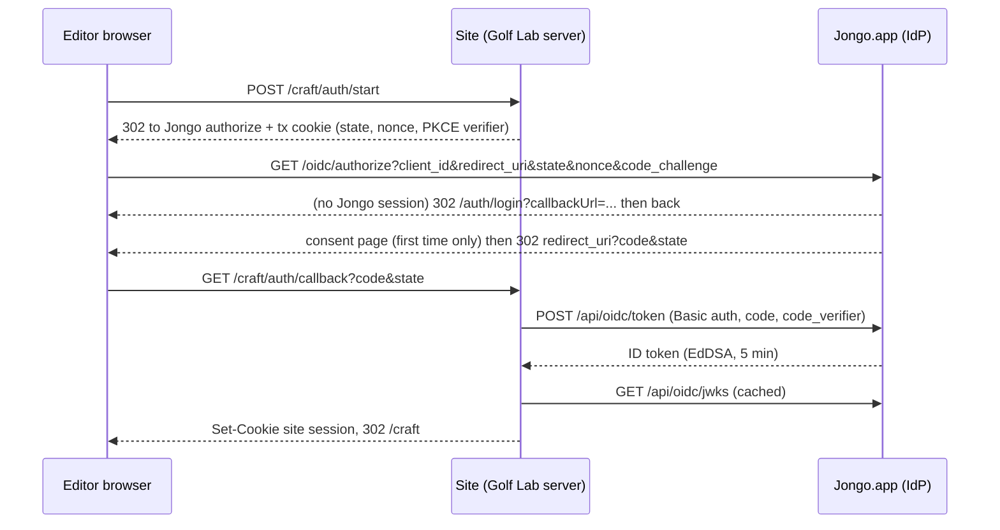

# Sign in with Jongo: SSO for Craft-enabled customer sites

Status: **design proposal, 2026-11-05, branch `craft`. No code, migration or configuration is part of this document.** Nothing here has been run. Statements marked **(verified)** were read in the code on this branch; **(assumption)** means I could not verify it (for example anything that depends on production environment values, which were deliberately not read).

## 1. Goals, non-goals, threat model

**Goal.** An editor opens a customer site's Craft studio (first site: the Golf Lab, `dd-thegolflab`, Next.js on Coolify) and signs in with their existing Jongo account. Jongo.app is the identity provider (OIDC authorization code + PKCE). The site learns who the person is and what they may do to that site's dataset, and nothing else.

**Non-goals (v1).** No Jongo API access for the customer site (the ID token is not a bearer token for any Jongo API); no refresh tokens; no userinfo endpoint; no dynamic client registration; no SAML/SCIM; no social login; no front-channel/back-channel logout; no change to Jongo's own login, NextAuth configuration or roles.

**Who can sign in to which site.** A person can obtain a token for client *C* (one per site) only if, at the moment of authorization, `resolveDatasetCmsCapabilities(userId, C.datasetId)` (`jongo/apps/web/src/lib/cms/dataset-access.ts`, verified) says they can read that dataset. That function already encodes: live non-deleted user; live owner or organization member (or site member **with** an explicit dataset grant); unarchived dataset/site/organization. Platform admins, `super_admin` and the bootstrap email get **no** CMS access from it (verified, `docs/cms-persistence.md`, "Collaborator purchases ... provide no entitlement, CMS or financial bypass").

| Stolen thing | What it allows | Containment |
|---|---|---|
| Authorization code | Nothing without the client secret **and** the PKCE verifier | 60 s TTL, single use, bound to client, redirect URI and challenge |
| ID token | Replay at the same site's callback only; needs the matching `nonce` cookie, so effectively useless | `aud` = that site's `client_id`, 5 min `exp`, never accepted by Jongo APIs |
| Client secret | Cannot mint tokens (still needs a valid code + verifier); can probe the token endpoint | Hashed at rest, rotation with overlap, rate limits, audit |
| Site session cookie | Edit that one dataset with the stolen user's role until expiry | httpOnly, Secure, short absolute lifetime, `sub` deny-list, dataset bound |
| Jongo signing key | Forge identities for **every** connected site (worst case) | Secret store only, `kid` rotation, runbook, alerting; accepted residual risk of any IdP |
| Jongo session of an editor | Same as that user today, plus Craft access they already hold | Unchanged by this design |

## 2. Chosen approach and why

**OIDC authorization code + PKCE (S256 only), with the relying party (RP) as a confidential client.** The RP is the customer's Next.js *server* (route handlers), which can keep a secret, so it authenticates at the token endpoint with `client_secret_basic` **and** sends PKCE. Both, not either: PKCE binds the code to the browser that started the flow, the secret binds it to the registered server; together they cover code interception and a leaked secret. PKCE-only (public client) was rejected: the Golf Lab has a server and a secret store (Coolify environment), so dropping the secret buys nothing. No implicit or hybrid flow.

**Rejected: signed handoff** (Jongo signs `{sub, dataset, role, exp}` and redirects the browser to the site with it). It is acceptable only for a same-organization, same-operator internal tool. Here it fails because the token crosses the browser/URL (history, logs, referrers), has no client authentication, no one-time-use guarantee without extra state, no PKCE-style binding, and every site would reimplement verification. OIDC costs roughly the same number of endpoints (discovery, authorize, token, JWKS) and gives off-the-shelf, reviewed semantics.

**Context only (not a dependency):** Sanity authenticates studio users against Sanity's own identity service and then issues project-scoped tokens; the editor never has a per-site password. This design gives Craft the same user experience with Jongo.app as the identity service.

**Signing algorithm.** Jongo signs ID tokens with **EdDSA (Ed25519)**; the RP allowlist is `["EdDSA"]` (RS256 is permitted only if a future third-party RP library needs it). `none` and HMAC algorithms are never accepted. Use the `jose` package for JWS signing and verification rather than hand-parsing JWTs. `jose` is not in `jongo/apps/web/package.json` today (verified); adding it is a dependency decision for review. It would be an optional peer dependency of `@jongo/craft`, like `pg`.

## 3. Jongo-side components (all new, additive)

Stack facts (verified): Next `^15.5.23`, `next-auth ^4.24.15`, Prisma `^5.22.0`, Node 22 (`jongo/Dockerfile` `node:22-alpine`, `engines >=22.12`). Everything below is behind `JONGO_OIDC_ENABLED` (exact string `true`, default off) and returns 404 when off.

### 3.1 Endpoints and where they live

| Piece | Path | File location (new) | Public in middleware? |
|---|---|---|---|
| Discovery | `GET /.well-known/openid-configuration` | `apps/web/src/app/.well-known/openid-configuration/route.ts` (assumption: Next 15 App Router serves a dot-folder route; check in Phase 1) | Yes, exact path |
| JWKS | `GET /api/oidc/jwks` | `apps/web/src/app/api/oidc/jwks/route.ts` | Yes, exact path |
| Token | `POST /api/oidc/token` | `apps/web/src/app/api/oidc/token/route.ts` | Yes, exact path; authenticates the client itself |
| Authorize + consent | `GET/POST /oidc/authorize` | `apps/web/src/app/oidc/authorize/` (route + consent page) | **No.** Goes through the normal session gate |
| Userinfo | omitted in v1 (claims are in the ID token; discovery will not advertise it) | | |

Authorize is deliberately **not** public. The existing middleware (`jongo/apps/web/src/middleware.ts`, verified) redirects an unauthenticated request to `/auth/login?callbackUrl=<path+query>`, and the login page already accepts a same-origin path callback (`safeCallbackUrl` in `auth/login/page.tsx`, verified: must start with `/`, not `//`). So the existing login flow is reused with zero change to NextAuth. Consequence: `prompt=none` cannot be supported (the middleware redirects before the handler runs); re-authentication is a normal redirect that is invisible when the Jongo session is live and consent is remembered. Authorization-request validation (client, redirect URI) therefore happens after login; invalid client or redirect URI shows an error page on Jongo and **never** redirects.

**Middleware change (the only edit to existing code besides reading the session).** Three exact-path, method-restricted early returns next to the existing dataset-marketing exemption, which is the model to copy (verified: anchored regex, GET only, comment "Never add /api/content to startsWith exemptions"). Do **not** add anything to `PUBLIC_PATHS`: that list is matched with `startsWith` (verified), so an entry would expose every longer path sharing the prefix. Do not place endpoints under `/api/auth`, which is a public `startsWith` prefix and owned by the NextAuth catch-all (verified).

**Session read.** The authorize route calls `auth()` from `src/lib/auth.config.ts` (verified: it re-reads the user from the database and returns `null` for a deleted or missing user, so a JWT alone never authorizes). Note that `auth()` and the middleware both have a development bypass when `NEXTAUTH_SECRET` is unset or the dev default and `NODE_ENV !== "production"` (verified); the OIDC routes must refuse to run when `NODE_ENV === "production"` and the secret is missing or default.

### 3.2 Client registry (per Site)

One client per Site (decision, see section 9). New Prisma model `OidcClient`:

| Field | Notes |
|---|---|
| `id` uuid, `clientId` (unique, public, random `jc_` + 16 bytes base64url) | `clientId` is the `aud` |
| `organizationId`, `siteId`, `datasetId` | FKs to `Organization`, `Site`, `CmsDataset` (verified models). Dataset must belong to the same org and site (same composite check pattern as `CmsDataset` -> `Site` on `[siteId, organizationId]`) |
| `name`, `status` (`active` \| `disabled`) | |
| `secretHash`, `previousSecretHash`, `previousSecretExpiresAt` | SHA-256 of a 256-bit random secret (same hash-at-rest approach as `CmsDeliveryCredential.tokenHash`, verified); compared with `timingSafeEqual`. A password-grade KDF is unnecessary for a 256-bit random secret. Shown once at creation/rotation |
| `redirectUris String[]` | Exact string match, `https` only (loopback `http` allowed only when `NODE_ENV !== "production"`), no fragments, no wildcards |
| `allowedOrigins String[]` | Origins of the site; the redirect URI origin must be in it (guards typos and custom-domain drift) |
| `createdAt`, `rotatedAt`, `disabledAt`, `createdById` | |

Creating, rotating and disabling a client is an **organization admin / dataset admin** action (`canManageDataset`, verified in `dataset-access.ts`), written in a transaction with an `AuditLog` row, exactly like `mintMarketingDeliveryCredential` (`src/lib/cms/deliverycredentials.ts`, verified). Phase 1 ships this as an operator script (like `cms:release:marketing`, verified in `package.json`); a dashboard page can follow.

### 3.3 Authorization codes and consent

- `OidcAuthCode`: `id`, `codeHash` (unique, SHA-256 of 256-bit random code), `clientId`, `userId`, `redirectUri`, `codeChallenge` (S256), `nonce`, `authTime`, `expiresAt` (**60 s**), `consumedAt`. Redemption is one atomic `updateMany({ where: { codeHash, consumedAt: null, expiresAt: { gt: now } } })` with `count === 1`, the same compare-and-set idiom as `revokeMarketingDeliveryCredential` (verified). A second presentation of a consumed code is denied and audited as `oidc.code.replay`. Expired rows are deleted opportunistically on issue (no new scheduler).
- `OidcConsent`: unique `(userId, clientId)`, `grantedAt`, `revokedAt`. The "Allow" screen names the site, the dataset, the email and name that will be shared, and the role the person will have. It appears once per user and client; afterwards authorization is silent. The consent POST carries an HMAC-signed, expiring form token bound to user id and the exact request (state, nonce, challenge, redirect URI) plus a same-origin `Origin` check.
- No refresh tokens and no access tokens: **the ID token is the only artifact**, valid 5 minutes, used once at the callback. The site issues its own session cookie (section 4).

### 3.4 Claims (ID token)

Standard: `iss`, `sub`, `aud` (= `clientId`), `exp`, `iat`, `auth_time`, `nonce`, `jti`, `email`, `email_verified`, `name`. `sub` is `User.id` (UUID, stable; not the email, which can change). Jongo-specific object claim `craft`: `{ "dataset": "<CmsDataset.id>", "role": "reader|editor|publisher|admin" }`.

`craft.role` is the **effective** role, computed at authorization time from the capability bits of `resolveDatasetCmsCapabilities` (verified: it returns `canRead`, `canEdit`, `canPublish`, `canManageDataset`, intersected with the owner's active Studio/Scale subscription): `admin` if `canManageDataset`, else `publisher` if `canPublish`, else `editor` if `canEdit`, else `reader` if `canRead`, else **no code is issued**. A lapsed subscription therefore silently caps editors to `reader`, matching Jongo's own policy. Requires `JONGO_CMS_ENABLED=true`; if it is off the resolver denies everything and SSO fails closed (assumption: the flag's production value is unknown to me).

### 3.5 Signing keys

Env-based, names only (values live in the Coolify/secret store, never in git or logs): `JONGO_OIDC_ENABLED`, `JONGO_OIDC_ISSUER` (the public origin of Jongo; assumption: `https://jongo.app`, derive/confirm against `NEXTAUTH_URL`), `JONGO_OIDC_SIGNING_KEY` (Ed25519 private key, PKCS#8), `JONGO_OIDC_SIGNING_KID`, `JONGO_OIDC_PREVIOUS_PUBLIC_JWKS` (retired public keys still published). Rotation: generate new key, publish it in JWKS first (RPs refresh their cache), switch `SIGNING_KEY/KID`, keep the old public key in JWKS for at least the RP cache TTL plus max token lifetime (24 h is ample), then remove. No existing asymmetric signing code exists to reuse (verified: only HMAC helpers in `lib/invitations.ts`, `lib/github-install-state.ts`, and RS256-style `createSign` for the GitHub App in `lib/github-app.ts`); do not reuse `NEXTAUTH_SECRET` as a signing key.

### 3.6 Rate limits, audit, logout, revocation

- **Rate limits.** Reuse the in-process `RateLimiter` fixed-window class from `src/lib/contact-request.ts` (verified: process-local, resets on deploy, not shared across instances). Proposed: token endpoint 10/min per `(clientId, IP)` and 5 failed client authentications per 15 min per `clientId` (temporary lock, never auto-disable); authorize 30/min per user. Honest limit: per instance. Mitigated by 256-bit secrets and codes, so guessing is infeasible regardless; revisit with a shared store if Jongo runs multiple instances (assumption: single instance).
- **Audit.** `AuditLog` (verified fields: `organizationId` required, `actorId`, `action`, `resourceType`, `resourceId`, `details`, `ipAddress`, `userAgent`). New actions: `oidc.client.create|rotate|disable`, `oidc.consent.grant|revoke`, `oidc.code.issue|replay`, `oidc.token.issue|deny`. Details carry client id and reason codes only, never codes, secrets or tokens. Unknown-client requests have no organization to attach to; log those to the server log without parameters.
- **Logout.** Jongo logout does not propagate in v1 (no `end_session_endpoint`). A user who signs out of Jongo stays signed in to the site until its short session ends. The site has its own logout.
- **Revocation (user removed).** Removal takes effect at the next authorization (live resolver call) and, for an existing site session, when it expires (section 5).

### 3.7 Database migration

One additive Prisma migration, folder pattern `prisma/migrations/YYYYMMDDHHMMSS_oidc_provider/` (existing pattern verified: `20261019120000_cms_persistence_foundation`): create the `OidcClientStatus` enum and three tables (`OidcClient`, `OidcAuthCode`, `OidcConsent`) with their indexes and FKs (`ON DELETE RESTRICT` to Organization/Site/CmsDataset/User, matching the CMS convention; codes cascade from their client). **No ALTER of any existing table**, no data backfill, no new existing-table lock beyond a brief catalog lock for the FK. Safe to deploy with the flag off, and rollback is "leave the tables unused". Applied with `prisma migrate deploy` (script `db:migrate:deploy` verified; whether production applies migrations automatically on deploy is **unverified**, confirm the procedure before Phase 1). Also add a small SQL CHECK for code TTL and redirect URI `https` in the migration, as the CMS migration does for its constraints. Keep the migration disposable-database tested (pattern: `scripts/test-cms-migration.mjs`, verified to exist).

## 4. Relying-party side (customer site; Golf Lab first)

### 4.1 Flow and routes (`dd-thegolflab/src/app/craft/`)

1. `/craft/login` (exists, verified) gains a **Sign in with Jongo** button when `CRAFT_SSO_ENABLED=true`. It submits a POST to `/craft/auth/start`, same-origin checked by the existing `isSameOriginRequest` helper (`src/lib/craft/origin.ts`, verified present).
2. `start` generates `state` (128-bit), `nonce` (128-bit) and the PKCE verifier (256-bit); stores them in one short-lived (10 min) signed transaction cookie `craft_oidc_tx`; redirects to the authorize endpoint with `response_type=code`, `scope=openid email profile`, `code_challenge_method=S256`.
3. `/craft/auth/callback` (GET): reject `error`; require the tx cookie; compare `state` in constant time; **delete the cookie immediately** (single use); exchange the code server-to-server (5 s timeout, no redirect following, TLS to the pinned issuer); verify the ID token; create the session; redirect to `/craft`.

The tx cookie must be `SameSite=Lax`, **not** `Strict` like the current session cookie (verified `SameSite=Strict`, `Path=/craft`): the callback is a cross-site top-level navigation and a Strict cookie would not be sent. Also verify in Playwright whether the redirect from callback to `/craft` still carries a Strict session cookie after a cross-site-initiated chain (browser behavior varies; **to be verified**); the safe choice is `SameSite=Lax` for the new session cookie, relying on the existing same-origin checks on every action for CSRF (verified in `actions.ts` per `docs/craft-preview.md`).

### 4.2 ID token verification (all must pass, else deny)

| Check | Rule |
|---|---|
| Signature | Header `alg` in allowlist `["EdDSA"]`; `kid` found in cached JWKS from `CRAFT_SSO_ISSUER` discovery; no `jku`/`x5u`/embedded keys honored |
| `iss` | Exactly equals configured `CRAFT_SSO_ISSUER` (pinned; discovery document `issuer` must also match) |
| `aud` | Exactly `CRAFT_SSO_CLIENT_ID` (single value; `azp` if present equals it) |
| Time | `exp` in the future, `iat` not older than 5 min and not more than 60 s ahead (60 s skew, same as existing `CLOCK_SKEW_SECONDS` in `session.ts`, verified) |
| `nonce` | Equals the tx cookie nonce |
| Claims | `sub` UUID; `email_verified === true`; `craft.dataset === CRAFT_SSO_DATASET_ID`; `craft.role` in the four known roles |

JWKS caching: in memory, 10 min TTL; on unknown `kid` refetch once, rate limited to one refetch per minute; keep the last good set if Jongo is briefly unreachable (never fail open: no key, no login).

### 4.3 Role to Craft actions

The Craft contract (`jongo/craft/src/server/auth.ts`, verified): `authorize(actorId, action, datasetName)` over `read | read-drafts | write | publish | export | export-private | import | admin`, fail-closed (anything other than a resolved `true`, including a throw, denies).

| Jongo `craft.role` | Craft actions allowed |
|---|---|
| reader | `read` (published only; see note) |
| editor | `read`, `read-drafts`, `write` |
| publisher | editor + `publish` |
| admin | publisher + `export` |
| any role | `export-private`, `import`, `admin` **denied** unless explicitly granted by site configuration |

Note: the Studio lists and loads with the `previewDrafts` perspective, which needs `read-drafts` (verified in `service.ts`). A `reader` therefore cannot use the studio. Recommendation: the callback accepts readers but `/craft` shows a plain "you have view-only access" page. The authorize closure stays per call and per session, as `authorizeSession` does today (verified: `session !== null && datasetName === dataset && STUDIO_ACTIONS.has(action)`), now parameterized by the role in the session and by the configured Craft dataset name (`JONGO_CRAFT_DATASET`, default `production`, verified).

### 4.4 Site session

Reuse the existing stateless HMAC token design (`src/lib/craft/session.ts`, verified: `v1.<payload>.<sig>`, `timingSafeEqual`, expiry, clock skew, 8 h cap) as `v2` with payload `{ sid, sub, email, role, ds, iat, exp }`. Changes: absolute lifetime **2 h** (was 8 h; this is the revocation latency, see section 5); the actor id stored on Craft revisions and audit rows becomes `jongo:` (verified: actor id must be 1-128 chars without control characters) instead of the opaque `studio-session:<sid>`, giving per-person accountability. Cookie flags unchanged: `httpOnly`, `Secure` in production, path-scoped to `/craft`.

Server-side revocation (replacing the in-memory, per-instance `SessionRevocations`, whose limit is documented in `docs/craft-preview.md`): add a Craft migration `0002` in the site's own `craft` schema with a tiny `sso_revocations(sub, not_before)` table; sessions with `iat < not_before` for their `sub` are rejected, checked on each server action. Written on site logout and by an operator command ("revoke person X on this site now"). Rotating `JONGO_CRAFT_SESSION_SECRET` remains the global kill switch.

### 4.5 Break-glass password

Keep `JONGO_CRAFT_STUDIO_PASSWORD` login (verified, with rate limiting in `rate-limit.ts`). Env switch `CRAFT_BREAKGLASS_ENABLED`: default **true** while SSO is off, default **false** once `CRAFT_SSO_ENABLED=true` (must be explicitly set to `true` to coexist). Break-glass sessions get role `publisher`-equivalent actions (today's `STUDIO_ACTIONS`), actor id `breakglass`, are labeled in the UI, and every use is logged. Remove in Phase 3 after a rehearsal that proves recovery without it.

### 4.6 Packaging: shared helpers, not per-site code

New server-only entry **`@jongo/craft/auth`** (preferred over growing `@jongo/craft/server`, which is about PostgreSQL persistence and loads `pg`; the auth helpers need only Node crypto and optionally `jose`). It is a sibling subpath in `craft/package.json` exports (existing exports verified: `.`, `/content`, `/golf-lab`, `/logic`, `/server`, styles) and must not be reachable from client entries (same import-graph test as `/server`, verified in `craft/tests`). Surface (shape only):

- `createOidcRelyingParty(config)` -> `{ startLogin(), handleCallback(request, txCookie) }` returning redirect targets, cookies to set and a verified identity; takes issuer, client id/secret, redirect URI, expected dataset id, and an injectable `fetch` and clock (testable with a mock IdP).
- `verifyIdToken(token, options)` and a JWKS cache with the rules in 4.2.
- `actionsForRole(role)` and `authorizeForRole(role, datasetName, configuredDataset)` returning a Craft `Authorize`.
- A session codec for the `v2` token (sign/verify/expiry), reusing the algorithm in `session.ts`.

The site keeps only glue: three route handlers, the cookie plumbing and its environment names: `CRAFT_SSO_ENABLED`, `CRAFT_SSO_ISSUER`, `CRAFT_SSO_CLIENT_ID`, `CRAFT_SSO_CLIENT_SECRET`, `CRAFT_SSO_REDIRECT_URI`, `CRAFT_SSO_DATASET_ID`, `CRAFT_BREAKGLASS_ENABLED`, plus the existing `JONGO_CRAFT_SESSION_SECRET`.

## 5. Authorization model

- **Becoming an editor of a site's dataset** uses Jongo's existing, unmodified rules (verified, `dataset-access.ts`, `docs/cms-persistence.md`): organization owner and live organization `admin` -> dataset admin; live organization `collaborator` -> reader, raised by an explicit `CmsDatasetGrant` role (`reader|editor|publisher|admin`); a site-only collaborator needs an explicit grant on that exact linked dataset; a grant never replaces tenant membership; editing and publishing also require the owner's active subscription. SSO adds no new role tables.
- **Documentation conflict found:** the comment above `evaluateCmsEntitlement` in `lib/cms/entitlements.ts` says org admins stay read-only until explicit grants, while `dataset-access.ts` and `docs/cms-persistence.md` give org admins dataset admin. This design follows `dataset-access.ts`; the comment should be reconciled (not part of this change).
- **Platform admins and support.** No automatic access (verified: no bypass). Support gets access only by being added by the customer (collaborator plus grant), or by an owner-approved, time-boxed grant; every grant and every sign-in is audited. Recommended default in section 9.
- **Removal.** Remove a collaborator, soft-delete a user (`deletedAt`), revoke a grant or archive the dataset: the next authorization is denied (resolver reads live rows). An existing site session survives until its `exp` (2 h) unless revoked through the `sso_revocations` table. Accepted latency: **at most 2 h** by default; lower it or add a periodic re-authorization through the same redirect if the owner wants tighter control.
- **Isolation.** `aud` = the site's `clientId`; the RP rejects any `craft.dataset` other than its configured one; the IdP issues `craft.dataset` only from the client's own `datasetId`, never from a request parameter; the redirect URI must exactly match that client's registered list. A token for site A is useless at site B (wrong `aud`).

## 6. Security checklist

| # | Requirement | Where enforced |
|---|---|---|
| 1 | Exact string match on `redirect_uri` (authorize and token); error page, never redirect, on mismatch | IdP |
| 2 | PKCE `S256` mandatory; `plain` and missing challenge rejected | IdP + RP |
| 3 | `response_type=code` only; no implicit/hybrid; no `prompt=none` | IdP |
| 4 | Code single use (atomic compare-and-set), 60 s TTL, bound to client, redirect URI, challenge | IdP |
| 5 | `state` verified (constant time) and cookie deleted on first use; `nonce` verified | RP |
| 6 | Algorithm allowlist `EdDSA`; `none`/HMAC rejected; key chosen by `kid` from the pinned issuer's JWKS only | RP |
| 7 | Issuer pinned; discovery `issuer` must equal configured value; HTTPS only | RP |
| 8 | `aud`, `exp`, `iat`, skew 60 s, `email_verified`, `craft.dataset` checks | RP |
| 9 | Signing-key rotation with `kid` and overlap; key only in secret store | IdP |
| 10 | Client secret random 256-bit, hashed at rest, constant-time compare, shown once, rotation with overlap | IdP |
| 11 | Brute-force protection: rate limits plus failed-auth lock per client | IdP |
| 12 | No open redirect: redirects only to registered URIs; login `callbackUrl` limited to same-origin paths (existing rule) | IdP |
| 13 | CSRF: consent POST signed token + `Origin`; RP start POST same-origin; callback bound by `state` | both |
| 14 | Logs and audit never contain codes, tokens, secrets, verifiers, full URLs with query | both |
| 15 | Cookie flags: `httpOnly`, `Secure`, explicit `Path`, short `Max-Age`; tx cookie `Lax` and 10 min | RP |
| 16 | Responses `Cache-Control: no-store`; token endpoint rejects non-form content and CORS | IdP |
| 17 | Feature flag exact `true`; fail closed on any missing setting (same convention as `readCraftConfig`, verified) | both |

## 7. Rollout plan

| Phase | Scope | Acceptance |
|---|---|---|
| 0. Design review | This document, owner answers section 9 | Owner signs off decisions; migration procedure for production confirmed |
| 1. Jongo IdP behind `JONGO_OIDC_ENABLED`, staging client | Migration, endpoints, middleware exact paths, key env, client script, audit, rate limits | Flag off: every new path 404 and existing suite unchanged. Flag on (staging): discovery and JWKS valid; authorize/consent/token happy path; all negative tests in the matrix below pass; production Jongo untouched |
| 2. Golf Lab RP behind `CRAFT_SSO_ENABLED`, break-glass kept | `@jongo/craft/auth`, routes, `v2` session, `sso_revocations` | Real login from a staging Jongo account on the Golf Lab preview; role matrix verified end to end; removed user denied at next authorization; password login still works |
| 3. Production enablement, remove password | Real client, secrets in Coolify, break-glass default off, then removed | Two named editors sign in; revocation rehearsed; key-rotation rehearsed; recovery without the password rehearsed |

**Test strategy.**
- *Unit (Vitest in apps/web; `node --test` in craft and the site, existing conventions verified):* PKCE verification, code lifecycle, redirect matching (including trailing slash, case, userinfo, fragments), claim construction from capability bits, token verification vectors (wrong `alg`, `none`, wrong `iss`/`aud`/`nonce`/`exp`, unknown `kid`), role-to-action matrix, session `v2` tamper/expiry.
- *Integration with a mock IdP:* the RP helper against an in-process IdP built with the same signing code: key rotation mid-flow, JWKS outage, replayed code, clock skew.
- *Playwright end to end:* site -> Jongo login -> consent -> callback -> studio; second login is silent; wrong user denied; cookie attributes (including the Strict/Lax redirect question in 4.1).
- *Security tests:* open-redirect attempts, `state`/`nonce` mismatch, code replay, cross-client code redemption, token for site A at site B, forged cookies, rate-limit lockout, logs free of secrets.

## 8. Production risk to the live Jongo app

| Risk | Containment |
|---|---|
| Regression in login or middleware | NextAuth config **unchanged**; only an additive exact-path block in `middleware.ts`; `auth()` is only *read* by the authorize route; existing middleware/auth tests must pass and new tests must cover the exact-path bypass (no prefix leakage) before merge |
| Migration on live database | Additive only (new enum + 3 tables, no ALTER); tested on a disposable PostgreSQL; deployed with the flag off; rollback = leave unused |
| New public endpoints | Three exact paths, method-restricted; behind the flag (404 off); rate limited; no cookie or session use on them |
| Key mishandling | Dedicated Ed25519 key in the secret store; never `NEXTAUTH_SECRET`; rotation runbook tested in staging |
| Runtime | Production already on Node 22 (verified `Dockerfile`, `nixpacks.toml`, `engines >=22.12`), covering `jose` and `node:crypto` Ed25519 |
| Added load | Authorization reuses one `RepeatableRead` read per sign-in; token and JWKS are trivial; sign-ins are rare |

Required before merge: lint/type-check, the existing `apps/web` suite, a middleware test proving that only the three exact paths became public, the migration harness, and review of the secret handling.

## 9. Open questions and recommended defaults

| # | Question | Recommended default |
|---|---|---|
| 1 | One client per site, or per organization? | **Per site** (own secret, redirect URIs and dataset; revocable independently) |
| 2 | May plain collaborators publish? | **No.** Publishing needs an explicit `publisher` grant (current Jongo rule); org owner/admin publish |
| 3 | Platform-admin/support access policy | **No implicit access**; support must be added by the customer with a time-boxed grant; all audited |
| 4 | Token and session lifetimes | Code 60 s; ID token 5 min; site session **2 h** absolute, no refresh; consent remembered until revoked |
| 5 | Custom domains for sites | Each domain is an exact redirect URI and allowed origin; add/remove through client update (audited); no wildcards |
| 6 | Later support Google/GitHub login via Jongo? | **Yes, as Jongo-side login methods only** (the `User` model already has `authProvider`/`authProviderId`, verified); sites stay unchanged because they only trust Jongo |
| 7 | User removal without SCIM | Immediate at next authorization; existing sessions end at 2 h or via `sso_revocations`; an operator "revoke now" command |
| 8 | Does a `CmsDataset` row exist (or will it be created) for the Golf Lab in Jongo, separate from the Golf Lab's own `craft` database dataset? | **Yes, create one**; Jongo's dataset is the access-policy anchor (`craft.dataset` claim), the site maps it to its local `JONGO_CRAFT_DATASET` by configuration (assumption: not verified that Jongo has it today) |
| 9 | Should readers be able to sign in at all? | Yes, to a view-only page; no studio access |
